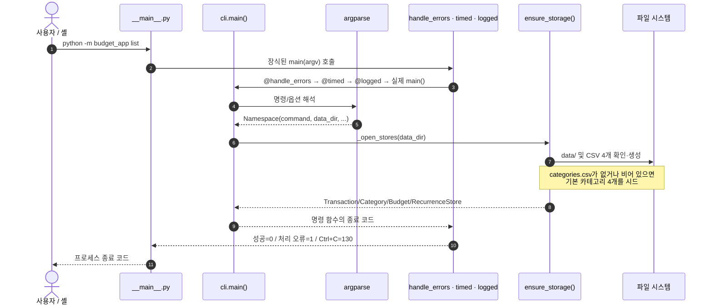
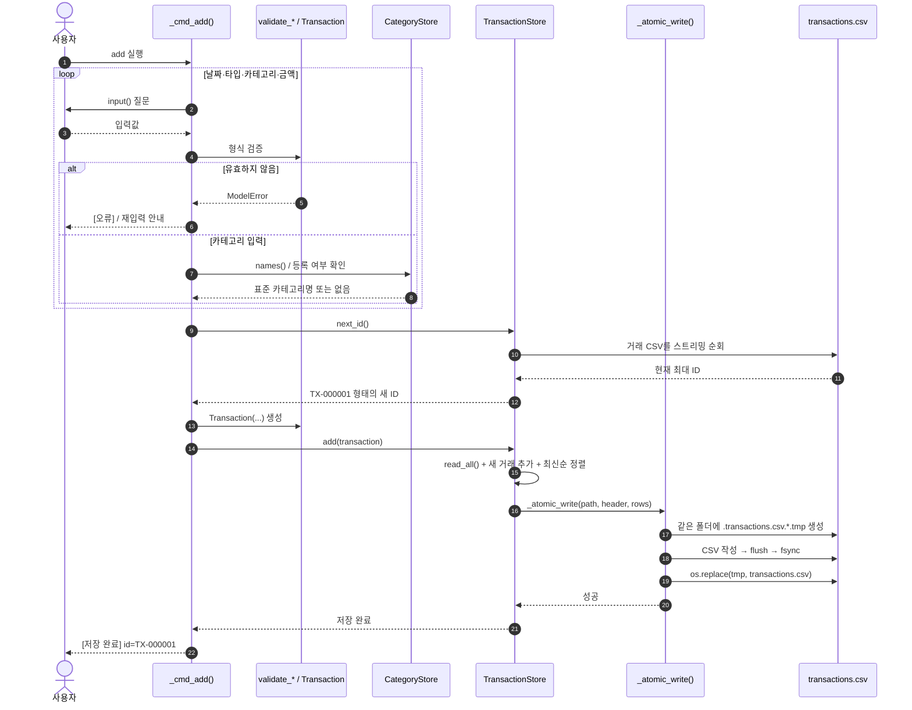
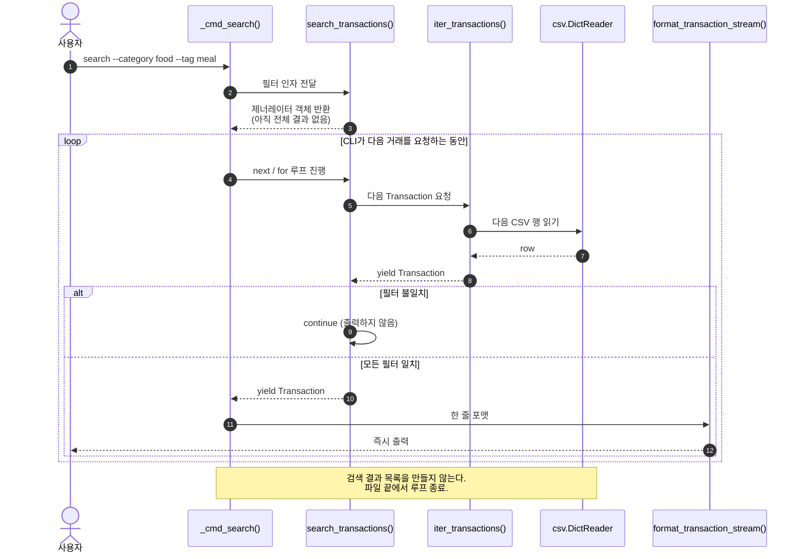
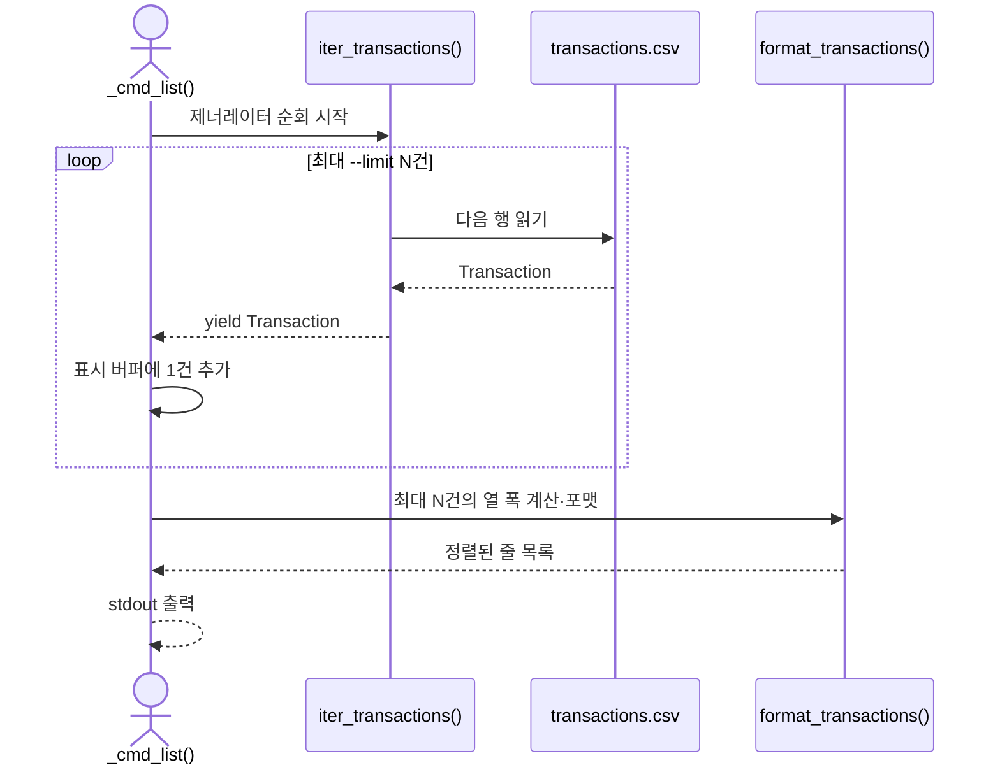
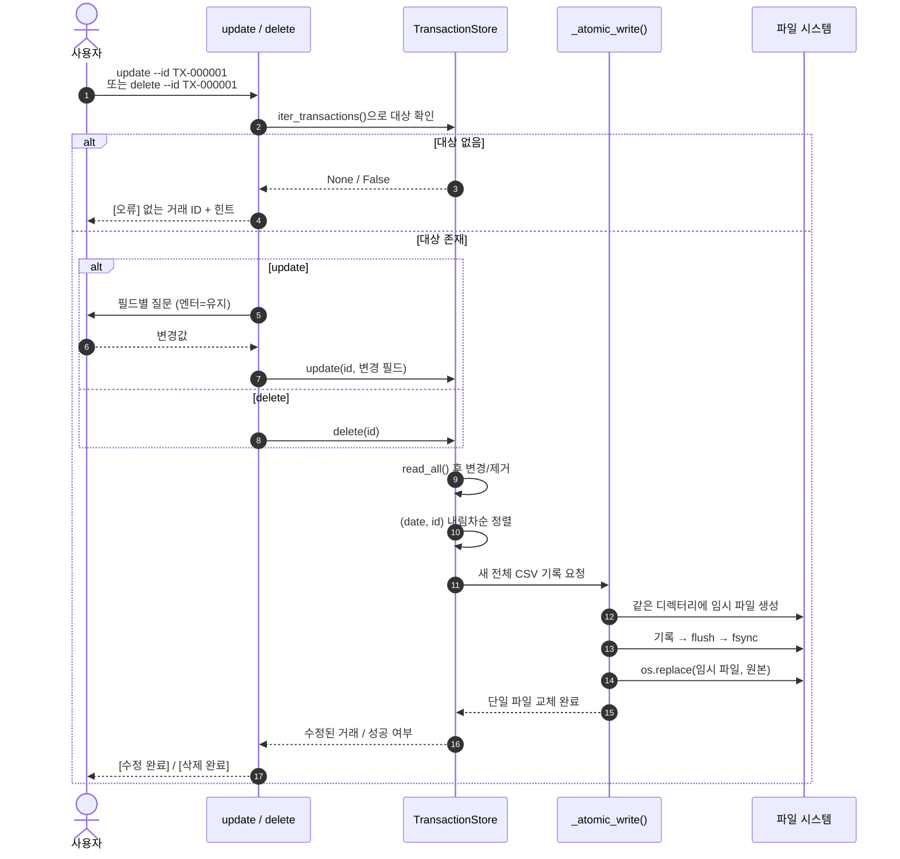
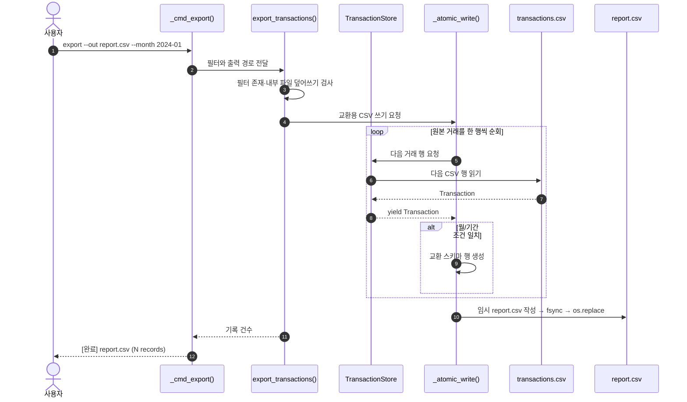
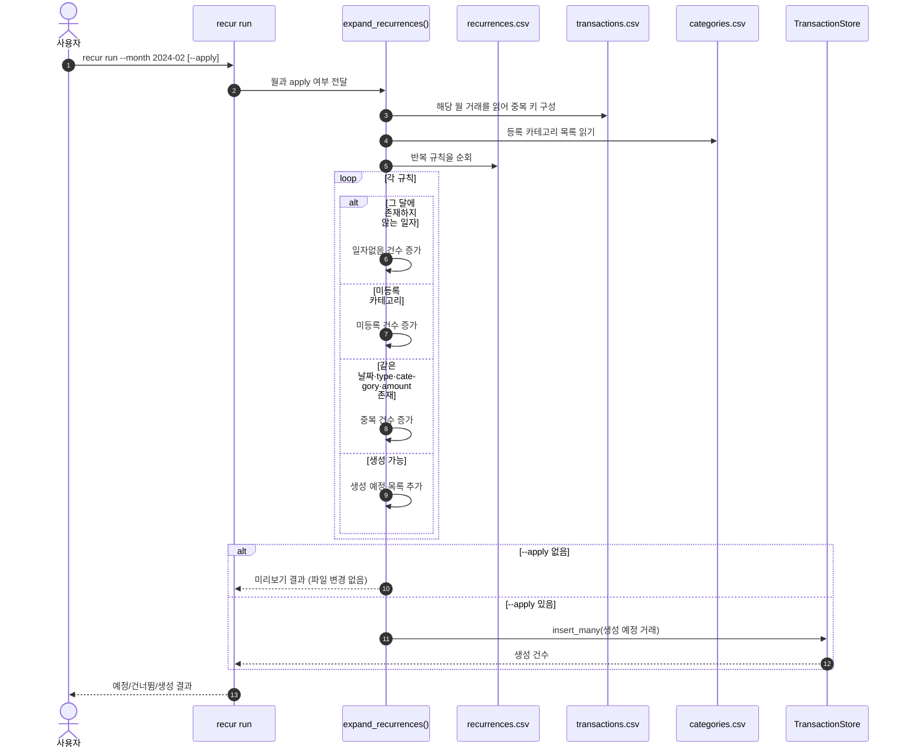
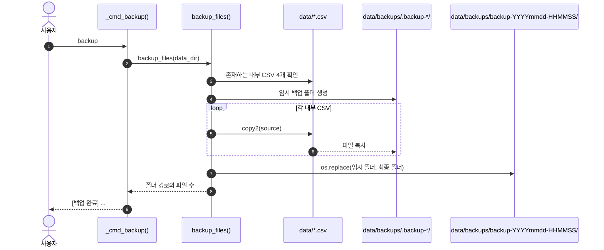

# 실행 흐름과 시퀀스 다이어그램

[← 프로젝트 소개](../README.md) · [아키텍처](architecture.md) · [저장 계약](storage.md) · [명령어](commands.md)

이 문서는 실제 코드의 호출 순서를 시각화합니다. 다이어그램은 GitHub Markdown에서 렌더링되는 **Mermaid** 문법을 사용합니다. 렌더링을 지원하지 않는 뷰어에서는 코드 블록으로 보이지만, 흐름 자체는 그대로 읽을 수 있습니다.

## 공통 시작: 명령 해석과 저장소 준비

모든 명령은 `python -m budget_app`으로 시작합니다. `__main__.py`가 `cli.main()`의 반환값을 프로세스 종료 코드로 전달하고, `main()`은 세 데코레이터로 감싸져 있습니다. 아래 저장소 준비 단계는 `list`처럼 내부 CSV를 사용하는 명령의 흐름입니다. `backup`은 `_open_stores()` 대신 `backup_files()`에서 대상 파일을 직접 확인합니다.



`argparse`의 잘못된 명령이나 옵션은 종료 코드 `2`를 냅니다. `handle_errors`는 `ModelError`, `StoreError`, EOF와 일반 예외를 `[오류]`·`[힌트]` 형식으로 stderr에 출력합니다. `logged`와 `timed`는 기본적으로 조용하며, `BUDGET_APP_LOG=DEBUG`일 때만 표준 logging으로 관측 정보를 남깁니다.

## 거래 추가: 대화형 검증 → 원자적 재작성

`add`는 한 줄을 단순히 파일 끝에 붙이지 않습니다. 새 ID를 계산하고 기존 거래와 함께 정렬한 뒤, 완성된 새 파일을 기존 파일과 교체합니다. 이 선택은 최신순 파일 순서와 실패 시 기존 파일 보존을 위한 것입니다.



> `add`, `update`, `delete`, `import`, `recur run --apply`는 거래 파일을 재작성합니다. 따라서 읽기 전용 명령처럼 완전한 상수 메모리 경로가 아닙니다. 소규모 파일 저장 프로그램에서는 단순성과 단일 파일 원자성을 우선한 선택입니다.

## `yield`와 스트리밍: list / search가 행을 읽는 방법

### `yield`는 무엇인가

일반 함수는 `return`으로 결과를 한 번에 넘기고 끝납니다. `yield`가 있는 함수는 **제너레이터(generator)** 를 반환합니다. 제너레이터는 호출만 했을 때 파일 전체를 읽지 않고, 소비자가 다음 값을 요청할 때마다 이전 위치부터 실행을 재개해 한 값씩 넘깁니다.

```python
def iter_transactions(self) -> Iterator[Transaction]:
    for line_no, row in _iter_rows(self.path, TXN_FIELDS):
        yield transaction_from_row(row)
```

| 방식 | 예 | 메모리 특성 |
| --- | --- | --- |
| 전체 로드 | `rows = list(iter_transactions())` | 거래 수 `N`개에 비례하는 메모리 `O(N)` |
| 스트리밍 | `for tx in iter_transactions(): ...` | 현재 행과 집계값 중심, 보통 `O(1)` 또는 제한된 크기 |

`yield`는 큰 파일을 **자동으로 빠르게 만드는 기능이 아닙니다.** 메모리 사용량을 제한하고, 필요한 만큼만 읽을 수 있게 만드는 제어 흐름입니다. 디스크에서 모든 행을 읽어야 하는 검색/요약의 전체 I/O 시간까지 사라지지는 않습니다.

### 검색: 생성 → 다음 행 요청 → 필터 → 출력



`search_transactions()`은 `--from`, `--to`, `--category`, `--type`, `--q`, `--tag`를 모두 만족하는 거래만 `yield`합니다. `list`도 저장소 읽기 자체는 스트리밍이지만, **출력 열 폭**을 맞추기 위해 `--limit` 이내의 거래만 목록에 잠시 보관합니다. 기본값 20이므로 이 버퍼는 최대 20건입니다.



### 스트리밍이 적용되지 않는 곳

| 기능 | 전체 데이터를 모으는 이유 |
| --- | --- |
| `add` / `import` | 기존 ID 중복 검사·새 ID 생성 후 정렬된 파일 전체 재작성 |
| `update` / `delete` | 대상 행을 변경/제거하고 나머지 행과 함께 새 파일로 재작성 |
| `summary` | 거래 행은 모으지 않지만 카테고리별 합계 `dict`는 유지 |
| `recur run --apply` | 해당 월의 중복 키와 생성할 거래 목록을 유지 |

파일 기반 구조에서 수정/삭제를 스트리밍 변환으로 구현할 수도 있지만, 현재 구현은 검증된 거래 전체를 메모리에 둔 다음 단순하게 정렬·원자 교체합니다. 데이터가 커지고 쓰기 빈도가 높아지면 SQLite 같은 DB 저장소가 더 적합합니다.

## 수정과 삭제: 읽기 → 변환 → 임시 파일 → 교체



`os.replace()` 이전에 실패하면 기존 `transactions.csv`는 그대로 남습니다. 단, 이 다이어그램은 **한 프로세스·한 파일** 기준입니다. 같은 파일을 여러 프로세스가 동시에 수정하는 문제는 해결하지 않습니다. 자세한 보장 범위는 [저장 안정성 문서](storage.md#쓰기-안정성과-한계)를 참고하세요.

## CSV 내보내기와 가져오기

### export: 읽기는 스트리밍, 출력 파일은 원자적 교체



### import: 외부 행 검증 → 일괄 저장

```mermaid
sequenceDiagram
    autonumber
    actor User as 사용자
    participant CLI as _cmd_import()
    participant Service as import_transactions()
    participant ImportCSV as incoming.csv
    participant Category as CategoryStore
    participant Store as TransactionStore
    participant Atomic as _atomic_write()

    User->>CLI: import --from incoming.csv
    CLI->>Service: 파일 경로 전달
    Service->>ImportCSV: 헤더 검사 (UTF-8, 필수 컬럼)
    alt 헤더/CSV 문법 오류
        ImportCSV-->>CLI: StoreError; 거래 파일 변경 없음
    else 파일 정상
        Service->>Category: 등록 카테고리 목록 읽기
        loop 외부 CSV의 각 행
            Service->>Service: 날짜·type·금액·태그·카테고리 검증
            alt 유효한 행
                Service->>Service: 새 Transaction 및 새 ID 목록에 추가
            else 잘못된 행 / 미등록 카테고리 / 초과 컬럼
                Service->>Service: skipped += 1
            end
        end
        Service->>Store: insert_many(유효 거래 목록)
        Store->>Atomic: 전체 transactions.csv 재작성
        Atomic-->>Store: os.replace로 교체
        Store-->>CLI: imported / skipped 수
        CLI-->>User: [완료] imported=N, skipped=M
    end
```

행 단위 오류는 건너뛰지만, 헤더 오류나 깨진 CSV 인용 문법처럼 **파일 구조 자체가 유효하지 않은 경우에는 일괄 저장 전에 실패**합니다. 따라서 그 경우에는 일부 행만 가져와지는 상태가 생기지 않습니다. 교환 CSV의 정확한 규약은 [저장 파일 문서](storage.md#importexport-교환용-csv)를 참고하세요.

## 반복 거래와 백업





백업 폴더는 완성된 파일이 모두 복사된 뒤 공개됩니다. 다만 백업 도중 다른 프로세스가 원본 네 파일을 수정하면 하나의 일관된 시점 스냅샷은 보장하지 않습니다.
